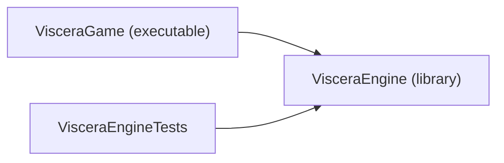

# Viscera

A learning game-engine project in modern C++, taking heavy inspiration from classic Doom gameplay mods such as **Brutal
Doom** and **Project Brutality** (over-the-top combat, gore, and weapon feel).

## Overview

Viscera is a personal learning codebase for building a small game engine and a game that rides on top of it. The repo is
split into a reusable **engine** library and a thin **game** executable that will grow into the actual player
experience. Today the scaffold is minimal (version reporting and tests); the goal is to explore rendering, input,
assets, and game logic in a structure that stays easy to extend.

**Status:** early scaffold — `0.0.1`, engine API surface is intentionally small.

## Tech Stack

| Layer           | Technology              | Version / notes                        | Source                                                                |
|-----------------|-------------------------|----------------------------------------|-----------------------------------------------------------------------|
| Language        | C++                     | C++23 (`cxx_std_23`)                   | Root `CMakeLists.txt`, `engine/CMakeLists.txt`                        |
| Build           | CMake                   | 3.28 or newer (policies through 4.4.5) | `CMakeLists.txt`, `CMakePresets.json`                                 |
| Generator       | Ninja                   | Preset default                         | `CMakePresets.json`                                                   |
| Compiler        | **Clang, GCC, or MSVC** | `clang++`, `g++`, or `cl`              | `cmake/CompilerWarnings.cmake`, presets                               |
| Tests           | GoogleTest              | v1.18.0 (FetchContent)                 | `cmake/Dependencies.cmake`                                            |
| Static analysis | clang-tidy              | Optional at build time                 | `.clang-tidy`, `VISCERA_CLANG_TIDY`                                   |
| Static analysis | cppcheck                | Optional at build time                 | `.cppcheck-suppressions`, `VISCERA_CPPCHECK`; `.cppcheck` is GUI-only |
| Formatting      | clang-format            | Project `.clang-format`                | `.clang-format`                                                       |
| API docs        | Doxygen                 | Optional; CMake `docs` target          | `VISCERA_BUILD_DOCS`, preset `docs`                                   |

Supported compilers are **Clang** (including AppleClang), **GCC** (`g++`), and **MSVC** (`cl`). Configuration fails
if CMake reports another compiler id, including **clang-cl**. The check lives in
[`cmake/CompilerWarnings.cmake`](cmake/CompilerWarnings.cmake). Presets `debug` and `release` use Clang. GCC and MSVC
have their own presets, listed under [Configuration](#configuration).

## Architecture

- **Style:** modular monolith — static engine library + game executable, with CMake targets as module boundaries.
- **Entry points:**
    - Game: `game/src/main.cpp` → `VisceraGame`
    - Engine library: `engine/` → `VisceraEngine` (`Viscera::Engine`)
    - Tests: `engine/tests/src/EngineTests.cpp` → `VisceraEngineTests`



### Directory map

| Path                | Purpose                                                                                  |
|---------------------|------------------------------------------------------------------------------------------|
| `engine/`           | Engine library — public headers under `include/viscera/`, implementation in `src/`       |
| `game/`             | Game target that links `Viscera::Engine`                                                 |
| `engine/tests/`     | GoogleTest suite for the engine (top-level builds only)                                  |
| `cmake/`            | Shared CMake modules (`Dependencies.cmake`, `CompilerWarnings.cmake`)                    |
| `CMakePresets.json` | Debug / Release presets for Clang, GCC, and MSVC, plus clang-tidy, cppcheck, and Doxygen |

Build outputs (binaries) are written under `<build-dir>/bin/` (for example `cmake-build-debug/bin/VisceraGame`).

## Prerequisites

Install these before configuring the project:

1. **A C++23 compiler** — one of the following:
    - **LLVM Clang** — a recent Clang. On Windows, the [LLVM installer](https://releases.llvm.org/), a package
      manager, or the [WinLibs](https://winlibs.com/) build below; put `clang` and `clang++` on `PATH`. AppleClang
      is accepted when `clang++` is the Apple compiler.
    - **GCC** — a recent `gcc` / `g++` with C++23 support. On Windows, [WinLibs](https://winlibs.com/), MinGW, or
      MSYS2, with both binaries on `PATH`.
    - **MSVC** — Visual Studio 2022 or newer with the Desktop development with C++ workload. Configure `debug-msvc`
      or `release-msvc` from an **x64 Native Tools** or **Developer PowerShell** prompt so `cl` is on `PATH`.
2. **CMake** — 3.28 or newer. The `3.28...4.4.5` line in `CMakeLists.txt` is a minimum plus a policy ceiling, not an
   upper bound on the CMake version.
3. **Ninja** — Used by all presets in `CMakePresets.json`.
4. **Git** — Required for CMake `FetchContent` when tests are enabled (GoogleTest).

### Windows with WinLibs

On Windows, one [WinLibs](https://winlibs.com/) archive covers most of the list above. Choose the latest **Win64**
build with the **UCRT** runtime, **POSIX** threads, and the download labeled **with LLVM/Clang/LLD/LLDB**. Extract it
and add its `mingw64\bin` directory to `PATH`. That path must not contain spaces.

That directory provides:

- `gcc` and `g++`
- `clang` and `clang++`, and with them `clang-tidy` and `clang-format`
- `cppcheck`
- `cmake` and `ninja`

Clang presets (`debug`, `release`, and the analysis presets) need the archive labeled **with LLVM/Clang/LLD/LLDB**.
The GCC-only archive is enough for `debug-gcc` and `release-gcc`. Install Git separately so CMake can fetch
GoogleTest. MSVC presets still need Visual Studio's `cl` on `PATH`.

**Optional**

- **clang-tidy** — Bundled with LLVM, including the WinLibs archive **with LLVM/Clang/LLD/LLDB**. The
  `debug-clang-tidy` and `debug-analysis` presets enable it on the Clang `debug` build. With GCC or MSVC,
  `-DVISCERA_CLANG_TIDY=ON` warns at configure and skips the tool.
- **cppcheck** — Included in the WinLibs archive **with LLVM/Clang/LLD/LLDB**. Enable via the `debug-cppcheck` or
  `debug-analysis` preset, or `-DVISCERA_CPPCHECK=ON`. CMake runs cppcheck on compiled translation units. The
  `.cppcheck` file is only for the Cppcheck GUI; it is not the CLion or CMake gate.
- **CLion** — The repo includes `.idea/` metadata; opening the folder and using CMake presets matches local workflow.
  On-the-fly Cppcheck is disabled in the project inspection profile because it does not use `compile_commands.json`.
  Use `debug-analysis` or the `VisceraCppcheck` target. A yellow underline whose tooltip starts with `Cppcheck:` is
  the IDE plugin; `Class is never used` is a CLion inspection, not cppcheck.
- **Doxygen** — Required only when generating API docs. Install from [doxygen.nl](https://www.doxygen.nl/download.html)
  or `winget install DimitriVanHeesch.Doxygen`, and put `doxygen` on `PATH`. Graphviz (`dot`) is optional; if CMake
  finds it, Doxygen draws UML-style class diagrams. Enable with the `docs` preset or `-DVISCERA_BUILD_DOCS=ON`.

## Getting Started

1. **Clone the repository**

   ```bash
   git clone https://github.com/zenvi-studio/Viscera.git
   cd Viscera
   ```

2. **Configure with a preset.** `debug` uses Clang. Use `debug-gcc` or `debug-msvc` for the other two.

   ```bash
   cmake --preset debug
   ```

3. **Build** with the same preset name:

   ```bash
   cmake --build --preset debug
   ```

   GCC and MSVC: `cmake --build --preset debug-gcc` and `cmake --build --preset debug-msvc`.

4. **Run the game**

   ```bash
   ./cmake-build-debug/bin/VisceraGame
   ```

   On Windows (PowerShell), from the repo root:

   ```powershell
   .\cmake-build-debug\bin\VisceraGame.exe
   ```

   GCC and MSVC presets write that executable under `cmake-build-debug-gcc/bin/` and `cmake-build-debug-msvc/bin/`.

5. **Run tests** (enabled by default for top-level builds)

   ```bash
   ctest --preset debug
   ```

   The same invocation with an explicit build directory:

   ```bash
   ctest --test-dir cmake-build-debug --output-on-failure
   ```

### Manual configure (without presets)

If you prefer an explicit build directory, pass the compiler yourself. Any other compiler id fails configure in
`cmake/CompilerWarnings.cmake`.

Clang:

```bash
cmake -S . -B cmake-build-debug -G Ninja \
  -DCMAKE_BUILD_TYPE=Debug \
  -DCMAKE_C_COMPILER=clang \
  -DCMAKE_CXX_COMPILER=clang++
cmake --build cmake-build-debug
```

GCC:

```bash
cmake -S . -B cmake-build-debug-gcc -G Ninja \
  -DCMAKE_BUILD_TYPE=Debug \
  -DCMAKE_C_COMPILER=gcc \
  -DCMAKE_CXX_COMPILER=g++
cmake --build cmake-build-debug-gcc
```

MSVC, from a Visual Studio developer shell:

```bash
cmake -S . -B cmake-build-debug-msvc -G Ninja \
  -DCMAKE_BUILD_TYPE=Debug \
  -DCMAKE_C_COMPILER=cl \
  -DCMAKE_CXX_COMPILER=cl
cmake --build cmake-build-debug-msvc
```

## Configuration

CMake options and cache variables used in this repo:

| Variable                                  | Default                         | Description                                                                                                                                                            |
|-------------------------------------------|---------------------------------|------------------------------------------------------------------------------------------------------------------------------------------------------------------------|
| `CMAKE_BUILD_TYPE`                        | Preset: `Debug` or `Release`    | Standard CMake build type                                                                                                                                              |
| `CMAKE_C_COMPILER` / `CMAKE_CXX_COMPILER` | Clang in `debug` / `release`    | `clang++`, `g++`, or `cl`. Other ids, including clang-cl, fail configure                                                                                               |
| `VISCERA_WARNINGS_AS_ERRORS`              | `OFF` in CMake; `ON` in presets | Compiler warnings fail the build (`CMAKE_COMPILE_WARNING_AS_ERROR`). Also passes `--warnings-as-errors=*` to clang-tidy and `--error-exitcode=1` to per-file cppcheck. |
| `VISCERA_CLANG_TIDY`                      | `OFF`                           | Run clang-tidy on Clang compilations via `CMAKE_CXX_CLANG_TIDY`. GCC and MSVC skip it with a warning                                                                   |
| `VISCERA_CPPCHECK`                        | `OFF`                           | Run cppcheck on every compilation via `CMAKE_CXX_CPPCHECK`, and add the `VisceraCppcheck` target                                                                       |
| `BUILD_TESTING`                           | CTest default when top-level    | Fetches GoogleTest and builds `VisceraEngineTests`                                                                                                                     |
| `VISCERA_BUILD_DOCS`                      | `OFF`                           | Adds the `docs` target, which runs Doxygen over public headers and `docs/`. Requires Doxygen on `PATH`                                                                 |

Configure presets:

| Preset             | Build directory            | Notes                                                        |
|--------------------|----------------------------|--------------------------------------------------------------|
| `debug`            | `cmake-build-debug`        | Clang, Debug, warnings as errors                             |
| `release`          | `cmake-build-release`      | Clang, optimized build, warnings as errors                   |
| `debug-gcc`        | `cmake-build-debug-gcc`    | GCC, Debug, warnings as errors                               |
| `release-gcc`      | `cmake-build-release-gcc`  | GCC, optimized build, warnings as errors                     |
| `debug-msvc`       | `cmake-build-debug-msvc`   | MSVC, Debug, warnings as errors; Windows only                |
| `release-msvc`     | `cmake-build-release-msvc` | MSVC, optimized build, warnings as errors; Windows only      |
| `debug-clang-tidy` | `cmake-build-clang-tidy`   | Inherits `debug` (Clang), plus `VISCERA_CLANG_TIDY=ON`       |
| `debug-cppcheck`   | `cmake-build-cppcheck`     | Inherits `debug` (Clang), plus `VISCERA_CPPCHECK=ON`         |
| `debug-analysis`   | `cmake-build-analysis`     | Inherits `debug` (Clang), plus clang-tidy and cppcheck       |
| `docs`             | `cmake-build-docs`         | `VISCERA_BUILD_DOCS=ON`, tests off; builds the `docs` target |

MSVC presets call `cl` by name, so configure them from a Visual Studio developer shell where `cl` is on `PATH`. There
are no project-specific environment variables for the current scaffold.

## Common Commands

| Task                               | Command                                                          |
|------------------------------------|------------------------------------------------------------------|
| Configure (Debug, Clang)           | `cmake --preset debug`                                           |
| Configure (Debug, GCC)             | `cmake --preset debug-gcc`                                       |
| Configure (Debug, MSVC)            | `cmake --preset debug-msvc`                                      |
| Configure (Release, Clang)         | `cmake --preset release`                                         |
| Configure (Release, GCC)           | `cmake --preset release-gcc`                                     |
| Configure (Release, MSVC)          | `cmake --preset release-msvc`                                    |
| Configure (Debug + clang-tidy)     | `cmake --preset debug-clang-tidy`                                |
| Configure (Debug + cppcheck)       | `cmake --preset debug-cppcheck`                                  |
| Configure (Debug + both analyzers) | `cmake --preset debug-analysis`                                  |
| Build                              | `cmake --build --preset <preset-name>`                           |
| Full cppcheck (not part of all)    | `cmake --build --preset debug-cppcheck --target VisceraCppcheck` |
| Run tests                          | `ctest --preset debug` (also `debug-gcc`, `debug-msvc`)          |
| Format (if clang-format installed) | `clang-format -i <files>` (project style in `.clang-format`)     |
| Generate API docs (Doxygen)        | `cmake --preset docs` then `cmake --build --preset docs`         |

`CMAKE_EXPORT_COMPILE_COMMANDS` is enabled at the project root, so after configure you get `compile_commands.json` in
the build tree for IDE indexing and clang-tidy.

## API documentation (Doxygen)

There is no checked-in `Doxyfile`. When `VISCERA_BUILD_DOCS` is on, CMake finds Doxygen, writes a config in the build
tree, and exposes a `docs` target. That target is not part of `all`; you have to build it explicitly.

It scans public engine headers under `engine/include/` and the markdown under `docs/`. Paths matching `*/detail/*` and
`*/templates/*` are skipped. The landing page is [`docs/README.md`](docs/README.md). Only documented members are
extracted (`EXTRACT_ALL` is off); undocumented public symbols produce Doxygen warnings.

### Generate with the `docs` preset

```bash
cmake --preset docs
cmake --build --preset docs
```

The configure preset turns `VISCERA_BUILD_DOCS` on, turns tests off, and uses `cmake-build-docs`. The matching build
preset builds only the `docs` target.

Open `cmake-build-docs/docs/html/index.html` in a browser.

On Windows (PowerShell), from the repo root:

```powershell
start cmake-build-docs\docs\html\index.html
```

In CLion, select the `docs` CMake preset and build the `docs` target.

### Generate without presets

```bash
cmake -S . -B cmake-build-docs -DVISCERA_BUILD_DOCS=ON -DBUILD_TESTING=OFF
cmake --build cmake-build-docs --target docs
```

To attach the target to an existing tree (HTML then lands under that build directory):

```bash
cmake --preset debug -DVISCERA_BUILD_DOCS=ON
cmake --build --preset debug --target docs
```

That last form writes `cmake-build-debug/docs/html/index.html`.

Do not invoke `doxygen` by hand against the source tree; the generated Doxyfile lives in the build directory and is
what the `docs` target runs.

## Testing

- **Framework:** GoogleTest, discovered via `gtest_discover_tests` for `VisceraEngineTests`.
- **Location:** `engine/tests/`.
- **Example:** `EngineTests.ReturnsCorrectVersion` checks engine version `0.0.1`.

Tests are only added when `BUILD_TESTING` is on and this is the top-level project (`PROJECT_IS_TOP_LEVEL`).

## Project Conventions

- **Standard:** C++23, extensions off (`CMAKE_CXX_EXTENSIONS OFF`).
- **Warnings:** Compiler warning set on the `Viscera::Warnings` interface target (`cmake/CompilerWarnings.cmake`).
  Clang, GCC, and MSVC each get their own flags. Link the target on new product targets for consistency.
- **Headers:** First-party C++ headers use `.hpp`, including the public engine API under `engine/include/viscera/`.
  Version constants are generated from `Version.hpp.in` at configure time. `engine/CMakeLists.txt` collects
  `include/*.hpp`, and `.clang-tidy` limits header diagnostics to `.hpp` paths.
- **Aliases:** Prefer CMake targets `Viscera::Engine` and `Viscera::Warnings` when linking.
- **Style:** `.clang-format` and `.clang-tidy` at repo root; editor config in `.editorconfig`. Contributor workflow is
  in [CONTRIBUTING.md](CONTRIBUTING.md). Design judgment (SOLID, KISS, RAII, and related principles) is in
  [coding conventions](docs/foundation/guides/coding-conventions.md).

## Versioning

The project version is the `VERSION` argument of `project()` in the root [`CMakeLists.txt`](CMakeLists.txt). The
current version is `0.0.1`.

At configure time, [`engine/CMakeLists.txt`](engine/CMakeLists.txt) substitutes that version into
[`engine/include/viscera/Version.hpp.in`](engine/include/viscera/Version.hpp.in). The generated header defines:

- `viscera::kEngineVersion` — `std::string_view` holding the project version (`"0.0.1"`).
- `viscera::kVersionMajor`, `viscera::kVersionMinor`, and `viscera::kVersionPatch` — the three numeric components.

`viscera::Engine::version()` returns `kEngineVersion`.

Intentional releases are Git tags of the form `vMAJOR.MINOR.PATCH` (for example `v0.0.1`). Tag a release when you
mean to publish that version. Day-to-day commits stay untagged. Keep the Git tag, the CMake `VERSION`, and the matching
heading in [`CHANGELOG.md`](CHANGELOG.md) the same.

- **MAJOR** — incompatible changes to the engine API.
- **MINOR** — compatible additions.
- **PATCH** — compatible fixes.

## Troubleshooting

| Issue                                                 | What to check                                                                                                                                                                  |
|-------------------------------------------------------|--------------------------------------------------------------------------------------------------------------------------------------------------------------------------------|
| `Unsupported compiler` or `clang-cl is not supported` | Use Clang (`clang++`), GCC (`g++`), or MSVC (`cl`). A preset sets the compiler for you.                                                                                        |
| `'cl' is not recognized`                              | Open an x64 Native Tools or Developer PowerShell for Visual Studio, then configure `debug-msvc` or `release-msvc`.                                                             |
| Tests fail to fetch                                   | Network access for GitHub (`googletest` FetchContent) and Git installed.                                                                                                       |
| `clang-tidy` or `cppcheck` was not found              | Configure warns and continues. Install the tool, or leave `VISCERA_CLANG_TIDY` / `VISCERA_CPPCHECK` OFF.                                                                       |
| Wrong compiler in CLion                               | Settings → Build → CMake → select the preset for Clang, GCC, or MSVC.                                                                                                          |
| CLion yellow `unused` underlines, `analysis` is clean | Those marks are the on-the-fly Cppcheck plugin (disabled in this repo’s inspection profile). Hover: `Cppcheck:` vs `never used`. Rebuild `debug-analysis` for the real report. |
| `Could not find Doxygen` or no `docs` target          | Install Doxygen, put `doxygen` on `PATH`, and reconfigure with the `docs` preset or `-DVISCERA_BUILD_DOCS=ON`. Graphviz is optional.                                           |

## Documentation

Architecture decisions, diagrams, module docs, and coding conventions live under [`docs/`](docs/README.md). Foundation
ADRs (C++23, compilers, CMake layout, engine/game split, dependencies, warnings and static analysis, text policy) and
the [coding conventions](docs/foundation/guides/coding-conventions.md) guide are in
[`docs/foundation/`](docs/foundation/README.md).

Generated API HTML (Doxygen) is described under [API documentation (Doxygen)](#api-documentation-doxygen). Those pages
are build artifacts; they are not committed.

Contributor workflow: [`CONTRIBUTING.md`](CONTRIBUTING.md). Version history: [`CHANGELOG.md`](CHANGELOG.md). Fetched
dependencies: [`THIRD_PARTY_NOTICES.md`](THIRD_PARTY_NOTICES.md).

## License

MIT — see [LICENCE.txt](LICENCE.txt). Copyright (c) 2026 Cas Rovers.
