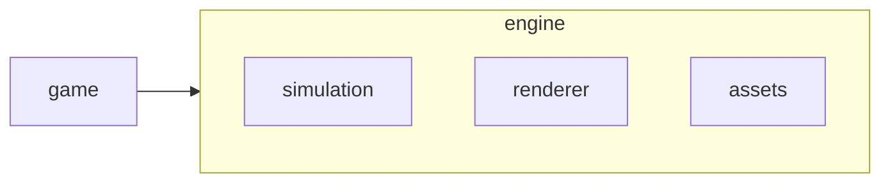
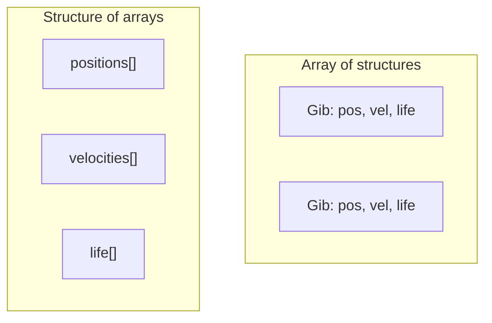

# Coding conventions {#foundation_conventions}

How Viscera code should be *shaped*: what belongs in a type, how modules talk to each other, and how C++ resources
are owned. This is a handbook, not an ADR. Toolchain and layout decisions stay in
[`docs/foundation/adr/`](../adr/).

Mechanical style (braces, names, includes) is not restated here:

- [`.clang-format`](../../../.clang-format) — formatting
- [`.clang-tidy`](../../../.clang-tidy) — checks and naming (`CamelCase` types, `camelBack` functions, `m_` members,
  `k` constants)

Examples below follow that style. They are sketches in a Viscera-like domain (weapons, entities, files, later GPU
handles). They are **not** files in the tree. `#include` lines and `namespace viscera` are omitted unless the point
needs them.

## How to use this guide

These principles are **judgment**. The compiler will not enforce them, and they sometimes pull in opposite directions.

When two principles conflict:

1. Prefer **KISS** and **YAGNI** until something hurts.
2. Duplicate once or twice (**WET** / **AHA**) rather than inventing a premature abstraction.
3. Extract (**DRY**) when the *same knowledge* has been copied a third time, or when a bug had to be fixed in more
   than one place.
4. Reach for **DoD** or clever performance code only after a **profiler** (or an obvious hot loop you already
   understand) says the simple version is the problem.

Read a section when you are about to add a type, split a module, or own a resource. Skim
[When principles collide](#when-principles-collide) if you are stuck between two “right” answers.

## Contents

- [SOLID](#solid)
  - [Single Responsibility Principle (SRP)](#single-responsibility-principle-srp)
  - [Open-Closed Principle (OCP)](#open-closed-principle-ocp)
  - [Liskov Substitution Principle (LSP)](#liskov-substitution-principle-lsp)
  - [Interface Segregation Principle (ISP)](#interface-segregation-principle-isp)
  - [Dependency Inversion Principle (DIP)](#dependency-inversion-principle-dip)
- [Pragmatic and simplicity principles](#pragmatic-and-simplicity-principles)
  - [Keep It Simple, Stupid (KISS)](#keep-it-simple-stupid-kiss)
  - [Don't Repeat Yourself (DRY)](#dont-repeat-yourself-dry)
  - [Write Everything Twice (WET) / Avoid Hasty Abstractions (AHA)](#write-everything-twice-wet--avoid-hasty-abstractions-aha)
  - [You Aren't Gonna Need It (YAGNI)](#you-arent-gonna-need-it-yagni)
- [Architecture and modularity](#architecture-and-modularity)
  - [Separation of Concerns (SoC)](#separation-of-concerns-soc)
  - [High Cohesion, Low Coupling (HCLC)](#high-cohesion-low-coupling-hclc)
  - [Law of Demeter (LoD)](#law-of-demeter-lod)
  - [Composition over Inheritance](#composition-over-inheritance)
  - [Encapsulate What Varies](#encapsulate-what-varies)
- [C++ structural paradigms](#c-structural-paradigms)
  - [Resource Acquisition Is Initialization (RAII)](#resource-acquisition-is-initialization-raii)
  - [Rule of Zero](#rule-of-zero)
  - [Rule of Five](#rule-of-five)
  - [Rule of Three](#rule-of-three)
  - [Data-Oriented Design (DoD)](#data-oriented-design-dod)
- [When principles collide](#when-principles-collide)
- [Related](#related)

## SOLID

Five object-oriented design rules. Used together they keep types small, substitutable, and dependent on stable
abstractions instead of concrete details.

In Viscera they apply mainly at **module and API boundaries** (engine vs game, public headers under
`engine/include/viscera/`). They are not a reason to turn every `struct` into an interface hierarchy. Hot simulation
loops may later look more like [DoD](#data-oriented-design-dod).

### Single Responsibility Principle (SRP)

**In one sentence:** A type or function should have one reason to change.

**What it means.** “Responsibility” is a *reason to change*, not a count of methods. A `Weapon` that fires, reloads,
and reports ammo still has one job: being a weapon. It starts violating SRP when it *also* loads textures, writes
save files, or talks to the network. Those change for unrelated reasons (art pipeline, save format, multiplayer).

**Why it matters here.** Engine and game code will grow weapons, gore, and UI. If `Weapon` knows about OpenGL and
JSON, a texture-path tweak forces you to reason about firing logic. Keep the fire loop easy to read.

**When not to apply it.** Do not split a 20-line type into five files “so each function has a class.” One cohesive
unit is SRP. Splitting too early fights [KISS](#keep-it-simple-stupid-kiss) and [YAGNI](#you-arent-gonna-need-it-yagni).

**Prefer** — firing is the weapon’s job; loading art is someone else’s:

```cpp
class Weapon
{
    public:
        void fire(World &world, const Vec3 &origin, const Vec3 &direction);
        void reload();

        [[nodiscard]] int ammoInMag() const;

    private:
        int m_ammoInMag{0};
        int m_magSize{30};
};

class TextureCache
{
    public:
        [[nodiscard]] const Texture &load(std::string_view id);
};
```

**Avoid** — one class that changes when combat *or* assets *or* saves change:

```cpp
class Weapon
{
    public:
        void fire(World &world, const Vec3 &origin, const Vec3 &direction);
        void loadModelFromDisk(const std::filesystem::path &path);
        void writeSaveJson(std::ostream &out) const;
        void uploadToGpu(GlDevice &device);

    private:
        int m_ammoInMag{0};
        GlTexture m_albedo{};
        std::string m_saveKey;
};
```

### Open-Closed Principle (OCP)

**In one sentence:** Add behaviour by extending, not by editing a growing pile of special cases.

**What it means.** “Closed for modification, open for extension” means a stable core should not need a new `if` or
`switch` arm for every new weapon, enemy, or damage type. Extension can be a new type, a data table, or a callback.
It does **not** mean a plugin loader on day one.

**Why it matters here.** Brutal-Doom-style combat invites lots of weapons and gore reactions. A 400-line
`switch (weaponId)` in the middle of the engine becomes the file everyone is afraid to touch.

**When not to apply it.** One `switch` over three enum values is fine. Wait until a fourth or fifth variant appears
before introducing virtual types or a table ([WET](#write-everything-twice-wet--avoid-hasty-abstractions-aha),
[YAGNI](#you-arent-gonna-need-it-yagni)).

**Prefer** — new damage behaviours are new types (or rows in a table), not edits to a central switch:

```cpp
struct Damage
{
    float amount{};
    DamageType type{DamageType::Bullet};
};

class Damageable
{
    public:
        virtual ~Damageable() = default;
        virtual void applyDamage(const Damage &damage) = 0;
};

class Imp : public Damageable
{
    public:
        void applyDamage(const Damage &damage) override;
};
```

A data table is also OCP, often simpler than inheritance:

```cpp
struct WeaponStats
{
    float damage{};
    int magSize{};
    int roundsPerMinute{};
};

const std::unordered_map<WeaponId, WeaponStats> kWeaponStats{
    {WeaponId::Pistol, {.damage = 15.0f, .magSize = 15, .roundsPerMinute = 300}},
    {WeaponId::Shotgun, {.damage = 20.0f, .magSize = 8, .roundsPerMinute = 80}},
};
```

**Avoid** — every new weapon edits the same function:

```cpp
float weaponDamage(WeaponId id)
{
    switch (id)
    {
        case WeaponId::Pistol:
            return 15.0f;
        case WeaponId::Shotgun:
            return 20.0f;
        // next weapon: another arm, another compile of this file
        default:
            return 0.0f;
    }
}
```

### Liskov Substitution Principle (LSP)

**In one sentence:** If code accepts a base type, every subtype must honour that contract.

**What it means.** Inheritance is a promise: “you can use me wherever you use my base.” Methods should not surprise
callers (throwing `not implemented`, no-opping a required operation, or tightening preconditions). If a type cannot
keep the promise, it should not inherit that base.

**Why it matters here.** Deep `Entity` trees are tempting in games. They go wrong when `Enemy` is an `Entity` but
`Entity::draw()` is meaningless for an off-screen AI-only actor, and the override throws.

**When not to apply it.** If you do not inherit, LSP does not apply. Prefer
[composition](#composition-over-inheritance) when the “is-a” story is already getting awkward.

**Prefer** — only types that can actually draw implement drawing:

```cpp
class IDrawable
{
    public:
        virtual ~IDrawable() = default;
        virtual void draw(IRenderer &renderer) const = 0;
};

class Sprite : public IDrawable
{
    public:
        void draw(IRenderer &renderer) const override;
};

class AiController
{
    public:
        void tick(float dt);
};
```

**Avoid** — a subtype that breaks the base contract:

```cpp
class Entity
{
    public:
        virtual ~Entity() = default;
        virtual void draw(IRenderer &renderer) const = 0;
};

class InvisibleTrigger : public Entity
{
    public:
        void draw(IRenderer &) const override
        {
            throw std::logic_error{"triggers are not drawn"};
        }
};
```

Callers with `Entity &` cannot use `InvisibleTrigger` safely. That is an LSP break.

### Interface Segregation Principle (ISP)

**In one sentence:** Depend on the small surface you actually need, not a fat “god” interface.

**What it means.** Clients should not be forced to implement (or even see) methods they do not use. Split wide
interfaces into roles: drawing, ticking, saving. A particle may be drawable and tickable but not networked.

**Why it matters here.** A single `IGameObject` with render, physics, audio, save, and net methods makes every dummy
object implement empty stubs, and every change to networking recompiles rendering.

**When not to apply it.** One interface with two methods used together is already segregated. Do not create
`IHasX` for every getter.

**Prefer** — roles are separate:

```cpp
class ITickable
{
    public:
        virtual ~ITickable() = default;
        virtual void tick(float dt) = 0;
};

class IDrawable
{
    public:
        virtual ~IDrawable() = default;
        virtual void draw(IRenderer &renderer) const = 0;
};

class Gib : public ITickable, public IDrawable
{
    public:
        void tick(float dt) override;
        void draw(IRenderer &renderer) const override;
};
```

**Avoid** — everything must implement everything:

```cpp
class IGameObject
{
    public:
        virtual ~IGameObject() = default;
        virtual void tick(float dt) = 0;
        virtual void draw(IRenderer &renderer) const = 0;
        virtual void save(SaveWriter &writer) const = 0;
        virtual void replicate(NetOutbox &out) const = 0;
        virtual void playHitSound(AudioMixer &mixer) const = 0;
};
```

### Dependency Inversion Principle (DIP)

**In one sentence:** High-level code depends on abstractions; details depend on those same abstractions.

**What it means.** Gameplay should not `#include` a concrete GL or Vulkan type. The engine publishes a small
interface (or a concrete type that *hides* the backend). The backend implements it. Both sides depend on the
abstraction, not on each other. This is the code-level version of
[ADR-004](../adr/ADR-004-engine-vs-game-split.md): game may depend on engine; engine must not depend on game.

**Why it matters here.** Swapping or wrapping a renderer should not rewrite weapon code. Tests can pass a fake
renderer.

**When not to apply it.** Do not invent `IFoo` for a type that has one implementation and no test double. A concrete
`Engine` with a stable API is already an abstraction from the game’s point of view.

**Prefer** — game talks to `IRenderer`; the GL backend lives behind it:

```cpp
class IRenderer
{
    public:
        virtual ~IRenderer() = default;
        virtual void drawSprite(const SpriteDraw &draw) = 0;
};

class GlRenderer : public IRenderer
{
    public:
        void drawSprite(const SpriteDraw &draw) override;
};

void drawHud(IRenderer &renderer, const HudState &hud)
{
    renderer.drawSprite(hud.crosshair);
}
```

**Avoid** — gameplay includes the backend:

```cpp
void drawHud(GlRenderer &renderer, const HudState &hud)
{
    renderer.bindPipeline(kHudPipeline);
    renderer.setUniform("uTint", hud.crosshairTint);
    renderer.drawIndexed(hud.crosshairMesh);
}
```

Now HUD code changes when the GL API changes, and a Vulkan backend cannot reuse it.

## Pragmatic and simplicity principles

These keep the codebase understandable while it is still a learning engine. They override SOLID when SOLID would add
ceremony without a second real use.

### Keep It Simple, Stupid (KISS)

**In one sentence:** Write the code you can still read in six months; cleverness is not a goal.

**What it means.** Simple means *obvious*, not *short*. A 15-line loop with clear names beats a one-liner dense with
templates, macros, or SIMD intrinsics. Do **not** write for performance first. Early “fast” code is often code you do
not understand, so you cannot debug it, test it, or make it actually fast later.

Correct order: make it work, make it clear, **then** (if a profiler points here) make it fast.

**Why it matters here.** Viscera is a learning codebase. Readable systems teach more than a hand-rolled allocator you
cannot explain. Doom-style combat feel comes from iteration, which needs code you are willing to change.

**When not to apply it.** Once a loop is measured hot and you understand the simple version, a DoD or SIMD rewrite of
*that loop* is fair. Do not simplify away safety ([RAII](#resource-acquisition-is-initialization-raii) is not
“clever”).

**Prefer** — obvious data and an obvious loop:

```cpp
void applyDamageToAll(std::vector<float> &health, float amount)
{
    for (float &value : health)
    {
        value = std::max(0.0f, value - amount);
    }
}
```

**Avoid** — “optimized” before anyone has profiled, and before the rule is even settled:

```cpp
template <std::size_t N>
inline void applyDamageToAllUnrolled(float *__restrict health, float amount)
{
    static_assert(N % 8 == 0);
    for (std::size_t i = 0; i < N; i += 8)
    {
        health[i] = health[i] < amount ? 0.0f : health[i] - amount;
        health[i + 1] = health[i + 1] < amount ? 0.0f : health[i + 1] - amount;
        // ... six more copies, plus a future SIMD path "for when we need it"
    }
}
```

### Don't Repeat Yourself (DRY)

**In one sentence:** Represent each piece of knowledge once.

**What it means.** DRY is about *knowledge*, not about *text that looks similar*. The rule “health is never below 0
and never above max” should live in one function. Two loops that both happen to walk a `std::vector` are not
duplication of knowledge; they are two jobs that share a language feature.

**Why it matters here.** Damage, ammo, and input will be touched from gameplay, UI, and saves. If the same clamp is
copied into five files, the sixth change (god-mode, armour, overheal) will miss one.

**When not to apply it.** Do not merge two similar-looking blocks that mean different things. That is hasty
abstraction — see [WET / AHA](#write-everything-twice-wet--avoid-hasty-abstractions-aha).

**Prefer** — one place knows the health rule:

```cpp
float clampHealth(float health, float maxHealth)
{
    return std::clamp(health, 0.0f, maxHealth);
}

void hurt(Living &living, float amount)
{
    living.health = clampHealth(living.health - amount, living.maxHealth);
}

void heal(Living &living, float amount)
{
    living.health = clampHealth(living.health + amount, living.maxHealth);
}
```

**Avoid** — the same rule restated until the copies drift:

```cpp
void hurt(Living &living, float amount)
{
    living.health -= amount;
    if (living.health < 0.0f)
    {
        living.health = 0.0f;
    }
}

void heal(Living &living, float amount)
{
    living.health += amount;
    if (living.health > 100.0f) // max used to be 100; Imp max is 60 — now wrong
    {
        living.health = 100.0f;
    }
}
```

Also avoid a catch-all helper just because two loops look alike:

```cpp
// Not DRY. Particles and HUD fades are different knowledge.
template <typename T, typename F>
void forEach(std::vector<T> &items, F &&fn)
{
    for (T &item : items)
    {
        fn(item);
    }
}
```

### Write Everything Twice (WET) / Avoid Hasty Abstractions (AHA)

**In one sentence:** Copy until the shared shape is real; abstract on the third use, not the first.

**What it means.** WET (“write everything twice”) and AHA (“avoid hasty abstractions”) are the brake on DRY. The first
time you write shotgun pellet spread, you do not know which parts will be shared with the rocket splash. A
`ProjectilePattern` framework at that point encodes guesses. After two similar systems, you may still wait. When a
*third* copy appears, or when a bug must be fixed in both, the abstraction has earned its keep.

DRY and WET are partners: DRY says “don’t scatter knowledge”; WET says “don’t invent a base class because two
functions both have a `for` loop.”

**Why it matters here.** Weapon feel will be discovered by experimenting. An early `IWeaponEffect` hierarchy is harder
to throw away than two concrete functions.

**When not to apply it.** If you already know it is the *same* rule (health clamp, version string), don’t copy it “to
stay WET.” WET is for *uncertain* similarity.

**Prefer** — two concrete functions while the designs are still diverging:

```cpp
void fireShotgun(World &world, const Vec3 &origin, const Vec3 &forward)
{
    constexpr int kPelletCount = 8;
    for (int i = 0; i < kPelletCount; ++i)
    {
        const Vec3 spread = spreadDirection(forward, kShotgunCone);
        world.spawnHitscan(origin, spread, kShotgunPelletDamage);
    }
}

void fireRocket(World &world, const Vec3 &origin, const Vec3 &forward)
{
    world.spawnProjectile(origin, forward, kRocketSpeed, kRocketSplashDamage);
}
```

**Avoid** — a framework for two call sites that only share “something comes out of the gun”:

```cpp
class IFiringPattern
{
    public:
        virtual ~IFiringPattern() = default;
        virtual void emit(World &world, const Vec3 &origin, const Vec3 &forward) = 0;
};

class PatternGraph
{
    public:
        void addNode(std::unique_ptr<IFiringPattern> node);
        void connect(int from, int to);
        void evaluate(World &world, const Vec3 &origin, const Vec3 &forward);
};
```

When a third weapon is clearly the same idea (another pellet spreader), then extract a `spawnPellets(...)` helper —
that is DRY with evidence.

### You Aren't Gonna Need It (YAGNI)

**In one sentence:** Build the thing you need now, not the hook you might need later.

**What it means.** Speculative flexibility (empty `Manager` types, event buses, plugin registries, `template` “just in
case”) costs reading time forever. Add the seam when a second caller, a test, or a real backend appears.

**Why it matters here.** It is easy to scaffold an ECS, a scene graph, and a resource manager before the first sprite
moves. Most of that will be wrong. The scaffold we already have (engine library + game executable) is enough structure
until a feature needs more.

**When not to apply it.** YAGNI does not excuse skipping [RAII](#resource-acquisition-is-initialization-raii), tests
for behaviour you *did* add, or the engine/game split already decided in ADR-004.

**Prefer** — a function that does the current job:

```cpp
void firePistol(World &world, const Vec3 &origin, const Vec3 &forward)
{
    world.spawnHitscan(origin, forward, kPistolDamage);
}
```

**Avoid** — infrastructure with no callers:

```cpp
class IWeaponService;

class WeaponServiceLocator
{
    public:
        static void registerService(std::string_view name, IWeaponService *service);
        static IWeaponService *resolve(std::string_view name);
};

class WeaponManagerFactory
{
    public:
        [[nodiscard]] std::unique_ptr<WeaponManager> create(const EngineConfig &config) const;
};
```

None of that helps the pistol fire.

## Architecture and modularity

How pieces sit next to each other: what a module owns, how little it needs to know about neighbours, and how it
hides the parts that will change.

### Separation of Concerns (SoC)

**In one sentence:** Split the work so each part has a clear job and a clear boundary.

**What it means.** A “concern” is a topic: rendering, input, gameplay rules, file I/O, build config. Mixing them in
one function produces code that is hard to test and hard to replace. SoC is SRP at *module* scale.

Viscera already separates **engine** (reusable runtime) from **game** (this title’s rules and content). That is
[ADR-004](../adr/ADR-004-engine-vs-game-split.md). Inside those trees, keep drawing code out of damage math, and keep
CMake policy out of C++ headers.

**Why it matters here.** Gore, weapons, and HUD will each change on their own schedule. A `Game::tick` that also
binds GL pipelines and parses JSON will stall all three.

**When not to apply it.** Tiny glue at the edge (the game `main` constructing an engine and calling `run`) may touch
more than one concern. That is composition, not a license to smear GL calls through weapon code.

**Prefer** — each layer owns one topic:

```cpp
void Game::tick(float dt)
{
    m_input.poll();
    m_world.simulate(dt);
    m_hud.sync(m_world);
}

void Game::render()
{
    m_renderer.beginFrame();
    m_world.draw(m_renderer);
    m_hud.draw(m_renderer);
    m_renderer.endFrame();
}
```

**Avoid** — simulate, draw, and disk I/O in one blob:

```cpp
void Game::tick(float dt)
{
    const int key = std::cin.get();
    m_player.health -= 3.0f;
    glBindTexture(GL_TEXTURE_2D, m_glHudTex);
    glDrawArrays(GL_TRIANGLES, 0, 6);
    std::ofstream{"autosave.json"} << m_player.health;
}
```



Game depends on engine. Engine modules may talk across a small API; they should not each reach into the other’s
private storage. Game never becomes a dependency of engine.

### High Cohesion, Low Coupling (HCLC)

**In one sentence:** Things that change together live together; they know as little as possible about everyone else.

**What it means.**

- **Cohesion:** members of a module belong to the same story. A weapon module that owns fire rate, mag size, and
  projectile spawn is cohesive. A `Utils` dump of unrelated helpers is not.
- **Coupling:** how much one module must know about another. Include a public header, call a function, that’s fine.
  Include another module’s *internals*, read its private fields, or depend on the order it ticks, that’s tight
  coupling.

Public engine API lives under `engine/include/viscera/`. Implementation lives in `engine/src/`. Game code should
include the public headers, not `engine/src/...`.

**Why it matters here.** Low coupling is what makes the engine reusable and the game replaceable. High cohesion is
what makes a folder navigable when you look for “where is ammo handled?”

**When not to apply it.** Two types that always change together may belong in the same file even if a purity test
would split them. Cohesion beats a large number of tiny, chatty types.

**Prefer** — a small public surface, details in the `.cpp`:

```cpp
// engine/include/viscera/Audio.hpp
class Mixer
{
    public:
        void play(std::string_view cueId);
};

// engine/src/Audio.cpp — file paths, decoders, backend types stay here
```

**Avoid** — every system reaches into every other system’s guts:

```cpp
void Hud::draw(IRenderer &renderer)
{
    renderer.drawText(m_world.m_player.m_weapon.m_mag.m_rounds);
    renderer.drawText(m_world.m_glDevice.m_lastFrameMs);
}
```

HUD now couples to world layout, weapon layout, magazine layout, and the GL device. A mag-size change ripples into
UI.

### Law of Demeter (LoD)

**In one sentence:** Talk to your immediate friends; don’t reach through them into their friends.

**What it means.** A function that has a `Player` should ask the player, not walk
`player.getWeapon().getMagazine().getRounds()`. Each extra `.get` is a dependency on someone else’s private
structure. When the magazine moves, every walker breaks.

**Fluent style** is welcome when the chain stays on **one** object that returns `*this` (or a small builder). That is
still talking to a single friend. Fluency that is only a chain of getters (`a.b().c().d()`) is the opposite of LoD.

**Why it matters here.** Game objects accumulate attachments (weapon, inventory, stats). Getter chains will show up
the first time someone builds a HUD. Hide those paths behind intent-revealing methods.

**When not to apply it.** Do not add a forwarding method for every nested field “just in case.” Forward the operations
callers actually need. A builder used at construction time is not a Demeter violation.

**Prefer** — ask the owner; fluent configuration stays on one type:

```cpp
int rounds = player.ammoInSlot(slot);

WeaponSpec spec = WeaponSpec{}
                      .withDamage(45.0f)
                      .withRpm(600)
                      .withMagSize(30);
```

```cpp
class WeaponSpec
{
    public:
        WeaponSpec &withDamage(float damage)
        {
            m_damage = damage;
            return *this;
        }

        WeaponSpec &withRpm(int rpm)
        {
            m_rpm = rpm;
            return *this;
        }

        WeaponSpec &withMagSize(int magSize)
        {
            m_magSize = magSize;
            return *this;
        }

    private:
        float m_damage{0.0f};
        int m_rpm{0};
        int m_magSize{0};
};
```

**Avoid** — train wreck through strangers; “fluent” getters that leak structure:

```cpp
int rounds = player.getInventory().getWeapon(slot).getMagazine().remaining();

player.getBody().getArm().getHand().getHeldItem().fire();
```

### Composition over Inheritance

**In one sentence:** Build behaviour by combining parts, not by stretching an “is-a” tree.

**What it means.** Inheritance is the right tool when you truly have a substitutable subtype (a `GlRenderer` *is an*
`IRenderer`). It is the wrong tool for sharing a few fields. An enemy *has* health, *has* a weapon, *may have* a
flying movement mode. Those are members (composition), not `Actor : Character : Enemy : FlyingEnemy : Imp`.

**Why it matters here.** Classic FPS entities share pieces (health, hitbox, gore) in different combinations. Deep
hierarchies force dummy overrides and LSP breaks. Composition lets an Imp and a barrel both have `Health` without
pretending a barrel is a `Character`.

**When not to apply it.** Do not ban inheritance. Interfaces for DIP/ISP, and short “is-a” backends (`GlRenderer` :
`IRenderer`), are inheritance used on purpose.

**Prefer** — parts you can mix:

```cpp
struct Health
{
    float current{100.0f};
    float max{100.0f};
};

struct Movement
{
    Vec3 velocity{};
    float maxSpeed{3.0f};
};

class Enemy
{
    public:
        void tick(float dt);

    private:
        Health m_health{};
        Movement m_movement{};
        Weapon m_weapon{};
};
```

**Avoid** — a taxonomy that only exists to share fields:

```cpp
class Actor
{
        Vec3 m_position{};
};

class Character : public Actor
{
        Health m_health{};
};

class Enemy : public Character
{
        Weapon m_weapon{};
};

class FlyingEnemy : public Enemy
{
        float m_altitude{};
};

class Imp : public FlyingEnemy
{
};
```

Every new mix (flying but unarmed, armed but stationary) adds another class or a dishonest override.

### Encapsulate What Varies

**In one sentence:** Put the part you expect to change behind a small door; leave the stable part alone.

**What it means.** Identify the decision that will move (damage scale by difficulty, input device, audio backend) and
hide it so callers ask “how much damage?” not “are we on Nightmare and is the victim an Imp?”. The “door” can be a
function, a settings struct, or later an interface. It should not be a strategy-pattern zoo before a second variant
exists.

**Why it matters here.** Feel (damage, recoil, gore amount) will be tuned constantly. If every system encodes its own
copy of the difficulty table, tuning becomes archaeology.

**When not to apply it.** If nothing varies yet, a constant is enough ([YAGNI](#you-arent-gonna-need-it-yagni)).
Encapsulate on the second real variant, or when the same `if (difficulty)` has already spread.

**Prefer** — one policy object; combat code stays dumb:

```cpp
struct DifficultySettings
{
    float playerDamageScale{1.0f};
    float enemyHealthScale{1.0f};
};

float outgoingDamage(float baseDamage, const DifficultySettings &settings)
{
    return baseDamage * settings.playerDamageScale;
}

void hurtEnemy(Living &enemy, float baseDamage, const DifficultySettings &settings)
{
    const float amount = outgoingDamage(baseDamage, settings);
    enemy.health = clampHealth(enemy.health - amount, enemy.maxHealth);
}
```

**Avoid** — the varying rule copied into every caller:

```cpp
void firePistol(Player &player, Living &target)
{
    float damage = 15.0f;
    if (player.difficulty == Difficulty::Nightmare)
    {
        damage *= 1.5f;
    }
    if (target.isImp)
    {
        damage *= 0.9f;
    }
    target.health -= damage;
}
```

The next weapon copies the same `if`s, then they drift.

## C++ structural paradigms

How Viscera uses the language so resources stay safe and data stays honest. Default: [Rule of Zero](#rule-of-zero)
plus [RAII](#resource-acquisition-is-initialization-raii). [DoD](#data-oriented-design-dod) is for measured hot paths,
not for the first version of a system.

### Resource Acquisition Is Initialization (RAII)

**In one sentence:** Owning a resource is a C++ object’s job; the destructor releases it on every exit path.

**What it means.** “Acquisition is initialization” means you take the resource in a constructor (or factory) and tie
its life to an object. When that object is destroyed — return, `break`, exception — the destructor runs. Files,
memory, locks, sockets, and later GPU buffers and window handles all follow this. You do not pair `new` with `delete`
by hand, or `fopen` with `fclose` on each `return`.

Standard library types already do this: `std::vector`, `std::string`, `std::unique_ptr`, `std::shared_ptr`,
`std::ifstream`, `std::lock_guard`. Prefer them. If you must wrap a C API, put the handle in a type whose destructor
calls the matching release function.

**Why it matters here.** Game engines leak for years when shutdown paths and error paths disagree. RAII makes the
happy path and the error path the same path.

**When not to apply it.** Non-owning views (`std::string_view`, `std::span`, raw pointers that do not own) are not
RAII objects. They must not outlive the owner. Do not add a custom RAII wrapper around `std::vector`; it already is
one.

**Prefer** — ownership in types that clean up themselves:

```cpp
void loadMap(const std::filesystem::path &path)
{
    std::ifstream in{path};
    if (!in)
    {
        return;
    }

    Map map = parseMap(in);
    m_world.spawn(map);
}

void withLock(std::mutex &mutex, const std::function<void()> &fn)
{
    const std::lock_guard lock{mutex};
    fn();
}

std::unique_ptr<IRenderer> makeRenderer()
{
    return std::make_unique<GlRenderer>();
}
```

**Avoid** — manual lifetime, easy to leak on early return:

```cpp
void loadMap(const char *path)
{
    std::FILE *file = std::fopen(path, "rb");
    if (file == nullptr)
    {
        return;
    }

    Map *map = new Map{};
    if (!parseMap(file, *map))
    {
        return; // leaked Map, leaked FILE
    }

    m_world.spawn(*map);
    delete map;
    std::fclose(file);
}
```

### Rule of Zero

**In one sentence:** Don’t write special members if members already manage themselves.

**What it means.** The *special members* are destructor, copy constructor, copy assignment, move constructor, and
move assignment. If every resource in your type is an RAII member (`std::vector`, `std::unique_ptr`, `std::string`,
…), the compiler-generated special members are correct. You write none of them. That is the Viscera default.

**Why it matters here.** Hand-written copies of containers are a common source of double-free and stale pointer bugs.
Zero is the Rule of Five you get for free.

**When not to apply it.** If you must own a raw handle the standard library cannot hold, you leave Zero and follow
the [Rule of Five](#rule-of-five). If the type should never be copied, `= delete` the copy operations (that is already
Five, not Zero).

**Prefer** — members do the work:

```cpp
class SpriteAtlas
{
    public:
        void add(std::string id, Texture texture);

        [[nodiscard]] const Texture *find(std::string_view id) const;

    private:
        std::unordered_map<std::string, Texture> m_byId;
};
```

No destructor, no copy, no move. `Texture` itself should also be Rule of Zero or a well-ruled Five.

**Avoid** — a destructor (or empty copy) “for later,” which suppresses implicit moves and is easy to get wrong:

```cpp
class SpriteAtlas
{
    public:
        ~SpriteAtlas()
        {
        }

        // copies now memberwise; if Texture becomes a raw GL id, this is a double-free
        // moves are suppressed because a user-declared destructor exists

    private:
        std::unordered_map<std::string, Texture> m_byId;
};
```

### Rule of Five

**In one sentence:** If you write one special member, define or `= delete` all five.

**What it means.** As soon as you declare a destructor (or a copy/move operation), the compiler’s remaining defaults
may not match what you want — especially moves. Spell them all out:

1. Destructor
2. Copy constructor
3. Copy assignment
4. Move constructor
5. Move assignment

Typical pattern for unique resources: delete copies, implement or default moves, implement the destructor.

`.clang-tidy` enables `cppcoreguidelines-special-member-functions` with
`AllowSoleDefaultDtor` and `AllowMissingMoveFunctionsWhenCopyIsDeleted`, so a defaulted destructor-only type and a
non-copyable type are allowed. Prefer still being explicit when you own a raw handle.

**Why it matters here.** GPU buffers, window handles, and file mappings will show up. A half-ruled type that copies a
handle and frees it twice will crash far from the bug.

**When not to apply it.** If you can store `std::unique_ptr` with a custom deleter, you can often get back to
[Rule of Zero](#rule-of-zero). Prefer that.

**Prefer** — all five accounted for (copies forbidden, moves and destructor real):

```cpp
class FileReader
{
    public:
        explicit FileReader(const std::filesystem::path &path);
        ~FileReader();

        FileReader(const FileReader &) = delete;
        FileReader &operator=(const FileReader &) = delete;

        FileReader(FileReader &&other) noexcept;
        FileReader &operator=(FileReader &&other) noexcept;

        [[nodiscard]] bool isOpen() const;

    private:
        std::FILE *m_file{nullptr};
};
```

Better still — Zero with a deleter, if the rest of the type allows it:

```cpp
struct FileCloser
{
    void operator()(std::FILE *file) const
    {
        if (file != nullptr)
        {
            std::fclose(file);
        }
    }
};

class FileReader
{
    public:
        explicit FileReader(const std::filesystem::path &path);

        [[nodiscard]] bool isOpen() const;

    private:
        std::unique_ptr<std::FILE, FileCloser> m_file;
};
```

**Avoid** — a destructor alone, copies still generated:

```cpp
class FileReader
{
    public:
        explicit FileReader(const std::filesystem::path &path);
        ~FileReader()
        {
            std::fclose(m_file);
        }

    private:
        std::FILE *m_file{nullptr};
};
```

Copying `FileReader` copies `m_file`. Both destructors call `fclose` on the same pointer.

### Rule of Three

**In one sentence:** The pre-C++11 version of the Rule of Five: destructor, copy constructor, copy assignment.

**What it means.** Older books and code talk about the Rule of Three because move operations did not exist yet. If a
class needed a custom destructor, it needed custom copying too (or copies disabled by a private unimplemented copy
constructor, in C++98 style).

In **C++23** (ADR-001) you do not stop at three. User-declared copies or a destructor affect generated **moves**.
Stopping at three can leave you with copies that work and moves that silently fall back to copies, or with suppressed
moves and needless extra allocation.

Treat Rule of Three as literacy: you will see it; you will not use it as the project rule. Default is Zero; otherwise
Five.

**Why it matters here.** Contributors coming from tutorials will add `~Foo()` and a copy constructor and think they
are done. Review should ask for the two move operations (or deletes).

**When not to apply it.** Do not write C++98-style private copy constructors. Use `= delete` and follow Five.

**Prefer** — the Five form (see above), even if you first noticed the type because of a destructor.

**Avoid** — “I implemented the Rule of Three” in new Viscera code:

```cpp
class GpuBuffer
{
    public:
        GpuBuffer(const GpuBuffer &other);
        GpuBuffer &operator=(const GpuBuffer &other);
        ~GpuBuffer();

        // moves never declared: expensive copies, or worse, a copied GL name

    private:
        unsigned int m_name{0};
        std::size_t m_bytes{0};
};
```

### Data-Oriented Design (DoD)

**In one sentence:** For hot loops, lay out data the CPU will actually scan; don’t hide it behind pointer graphs.

**What it means.** Object-oriented layout often looks like an **array of structures** (AoS): each `Enemy` is one
object with position, health, AI pointer, name, and vtable. Updating 10,000 positions then jumps around the heap.
**Structure of arrays** (SoA) stores `positions[]`, `health[]`, `alive[]` separately so a integrate-velocity loop
touches only the bytes it needs.

DoD also prefers **ids** over pointers (entity `32` rather than `Enemy*`), stable arrays, and explicit transforms
(`integrate(positions, velocities, dt)`) over virtual `entity->tick()` in the inner loop.

**Why it matters here.** Gore, particles, and many enemies are the first places a Doom-like game gets slow. When that
happens, DoD is the right tool. It is not the right tool for the engine’s public API or for a 12-line HUD.

**When not to apply it.** **DoD does not replace KISS on day one.** Start with the simplest layout you can explain
(usually a `std::vector` of a small struct). Split into SoA when the profiler (or an obviously huge particle loop)
says the layout is the cost. Do not build a full ECS to look like a data-oriented engine.

**Prefer (later, in a measured hot path)** — parallel arrays, integer ids:

```cpp
struct GibSoA
{
        std::vector<Vec3> positions;
        std::vector<Vec3> velocities;
        std::vector<float> life;
};

void integrateGibs(GibSoA &gibs, float dt)
{
    for (std::size_t i = 0; i < gibs.positions.size(); ++i)
    {
        gibs.positions[i] += gibs.velocities[i] * dt;
        gibs.life[i] -= dt;
    }
}
```

**Prefer (today, until it hurts)** — one simple struct in a vector:

```cpp
struct Gib
{
        Vec3 position{};
        Vec3 velocity{};
        float life{1.0f};
};

void integrateGibs(std::vector<Gib> &gibs, float dt)
{
    for (Gib &gib : gibs)
    {
        gib.position += gib.velocity * dt;
        gib.life -= dt;
    }
}
```

**Avoid as a default architecture** — pointer chasing and virtual calls per particle:

```cpp
class IEntity
{
    public:
        virtual ~IEntity() = default;
        virtual void tick(float dt) = 0;
};

class Gib : public IEntity
{
    public:
        void tick(float dt) override;

    private:
        std::unique_ptr<Transform> m_transform;
        std::unique_ptr<Velocity> m_velocity;
};

std::vector<std::unique_ptr<IEntity>> entities;
```



AoS is easier to read and is the default. SoA is what you move a *hot* system toward. SOLID still applies at the
boundary: `integrateGibs` can stay a free function in the engine; the game does not need to know the layout.

## When principles collide

Use this table when two sections both sound right.

| Tension | What to do |
|---------|------------|
| **DRY vs WET / AHA** | Same *knowledge* (one health rule) → DRY now. Same *shape* you are still guessing (two weapons) → copy. Third copy or a double bugfix → extract. |
| **KISS vs DoD / performance** | Ship the obvious loop. Profile. Rewrite the hot loop, not the whole architecture. |
| **SOLID vs DoD** | Interfaces and SRP at module boundaries (renderer, world, game). Arrays and ids inside measured simulation. A particle is data, not an `IGameObject`. |
| **OCP vs YAGNI** | A `switch` over three kinds is fine. Add a table or a type when the fourth kind would make the switch a bottleneck for *humans*. |
| **LoD vs fluent** | `builder.withDamage(x).withRpm(y)` on one object is good. `a.getB().getC().getD()` is not fluent, it is a train wreck. |
| **Zero vs Five** | Zero until you own a raw resource. Then Five (or wrap the resource so you can return to Zero). Never stop at Three in new code. |
| **ISP vs KISS** | Don’t split an interface used by a single caller into four headers. Split when a client is implementing empty stubs. |
| **Composition vs a real is-a** | `GlRenderer` is an `IRenderer` — inherit. `Imp` is not a `FlyingEnemyCharacterActor` — compose. |
| **SRP vs HCLC** | Don’t split a cohesive weapon type into `WeaponAmmo`, `WeaponFire`, `WeaponReload` classes. That’s one responsibility. |
| **SoC vs DIP** | Game depends on engine abstractions, not on GL. Don’t invert so far that the engine takes callbacks into game types (that would reverse ADR-004). |

If you are still unsure: write the smaller, more readable version. You can extract an abstraction tomorrow; you cannot
un-teach a confusing one as cheaply.

## Related

- [ADR-001: C++23](../adr/ADR-001-use-cpp23.md)
- [ADR-004: Engine vs game split](../adr/ADR-004-engine-vs-game-split.md)
- [ADR-006: Warnings and static analysis](../adr/ADR-006-warnings-and-static-analysis.md)
- [CONTRIBUTING.md](../../../CONTRIBUTING.md) — format, tidy, presets
- [`.clang-format`](../../../.clang-format), [`.clang-tidy`](../../../.clang-tidy)
